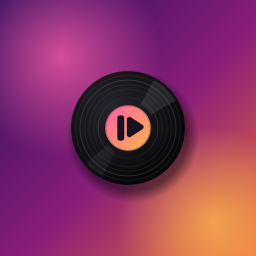
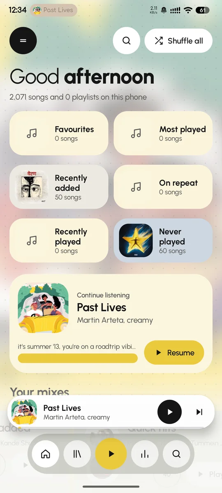
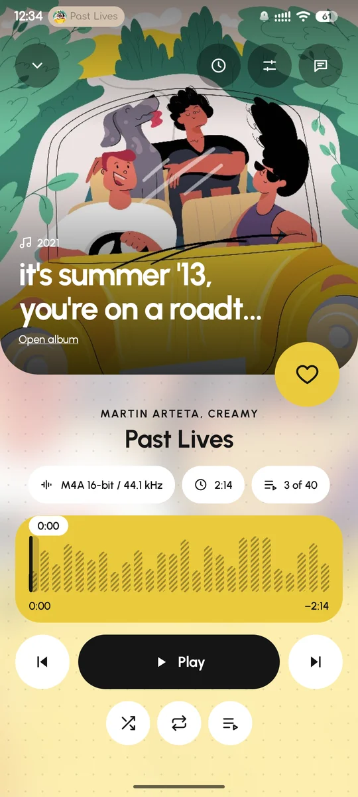
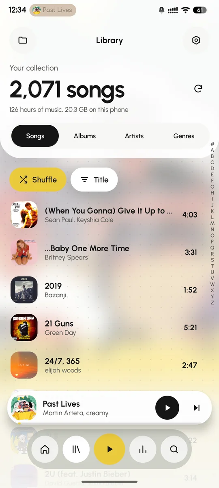
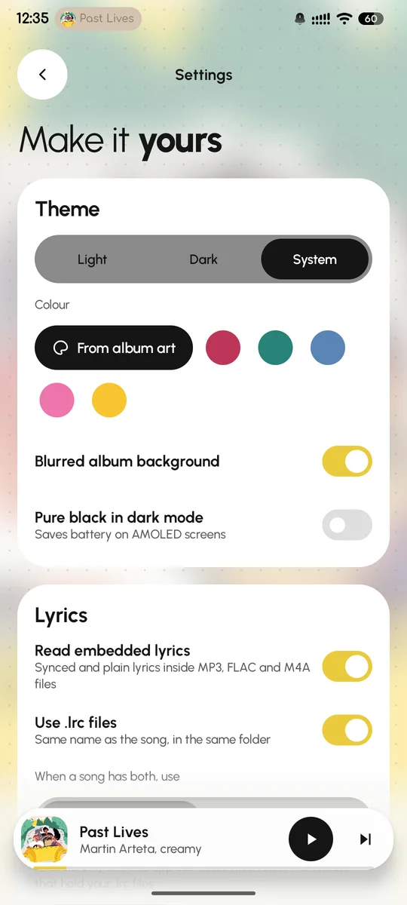

<div align="center">



# Kairos

**An offline music player for Android with time-synced lyrics, hi-res and bit-perfect audio, and a design that follows your album art.**

[](https://github.com/Arif1221/kairos/releases/latest)
[](https://github.com/Arif1221/kairos/actions/workflows/build.yml)
[](#requirements)
[](LICENSE)

[Download the APK](https://github.com/Arif1221/kairos/releases/latest) · [Report a bug](https://github.com/Arif1221/kairos/issues/new?template=bug_report.yml) · [Request a feature](https://github.com/Arif1221/kairos/issues/new?template=feature_request.yml)

</div>

Kairos plays the music already on your phone: MP3, FLAC, M4A/AAC, OGG, Opus and WAV. No account, no ads, no tracking, and no internet permission at all. It is built with Jetpack Compose and Media3 (ExoPlayer).

<p align="center">
  
  
  
  
</p>

## Features

**Lyrics**
- Time-synced lyrics with a karaoke-style fill that moves line by line, start to finish
- Reads lyrics embedded in the file (MP3 `USLT`/`SYLT`, FLAC Vorbis comments, M4A `©lyr`) and `.lrc` files next to your songs
- Word-level timestamps, `[offset]` tags, and a per-song timing fix in 0.1 s steps
- Tap a line to jump there

**Sound**
- Hi-res output (32-bit float) and bit-perfect USB output on Android 14+
- 10-band equalizer, bass boost and virtualizer
- ReplayGain (track and album), gapless playback
- Sleep timer that can fade out or stop at the end of the song

**Library**
- Songs, albums, artists and genres, with an A–Z fast scroller
- Songs with several artists ("A feat. B") show under each of them
- Choose which folders to scan; skip short clips
- Playlists, favourites, and auto playlists: Most played, On repeat, Recently added, Forgotten gems, genre mixes and more
- Listening stats: time listened, top songs and artists, streaks

**Design**
- The whole app takes its accent colour from the cover that is playing
- One player surface: swipe the mini player up into the full player and back down
- Swipe the cover to change song; swipe rows to play next or remove
- Light, dark and pure-black themes

## Download

Get the latest APK from [Releases](https://github.com/Arif1221/kairos/releases/latest). Play Store listing coming soon.

### Requirements
Android 9 (API 28) or newer. Bit-perfect USB output needs Android 14.

## Privacy

Kairos does not collect, send or share any data. It has no internet permission. Your library, playlists and listening history stay in the app's private storage on your phone. Read the full [privacy policy](PRIVACY.md).

## Build from source

You need Android Studio Ladybug (2024.2) or newer, or JDK 17 and the Android SDK.

```bash
git clone https://github.com/Arif1221/kairos.git
cd kairos
./gradlew assembleDebug          # debug APK in app/build/outputs/apk/debug/
./gradlew testReleaseUnitTest    # unit tests (lyrics parser)
```

Release builds are signed in CI with a key stored in GitHub secrets. Local release builds without that key are signed with your debug key, so they install on your own phone.

## How it is built

| Part | What it uses |
|---|---|
| UI | Jetpack Compose, Material 3, one `MainViewModel` exposing `StateFlow`s |
| Playback | Media3 ExoPlayer in a `MediaSessionService` (notification, lock screen, headset buttons) |
| Library | MediaStore scan into Room; settings in DataStore |
| Lyrics | A tag reader and LRC parser in plain Java, with no Android imports, so they run in unit tests |
| Colour | Palette API: the accent is the colour that covers the most of the cover |
| Audio | `DynamicsProcessing` EQ, float output, `AudioManager` mixer attributes for bit-perfect USB |

```
app/src/main/java/com/skarif/kairos/
├── ui/          screens, player layer, theme, motion tokens, components
├── playback/    PlaybackService, PlayerConnection, AudioEffects, BitPerfect
├── data/        Room database, MediaScanner, SettingsStore, Lyrics and Artwork repositories
└── lyrics/      TagReader and LrcParser (pure Java)
```

## Contributing

Bug reports, ideas and pull requests are welcome. Please read [CONTRIBUTING.md](CONTRIBUTING.md) first. For security issues, see [SECURITY.md](SECURITY.md).

## License

Kairos is free software under the [GNU General Public License v3.0](LICENSE). You can use, study, share and change it; versions you distribute must stay under the same licence.

The Urbanist font is under the [SIL Open Font License](app/src/main/assets/licenses/urbanist-OFL.txt).
